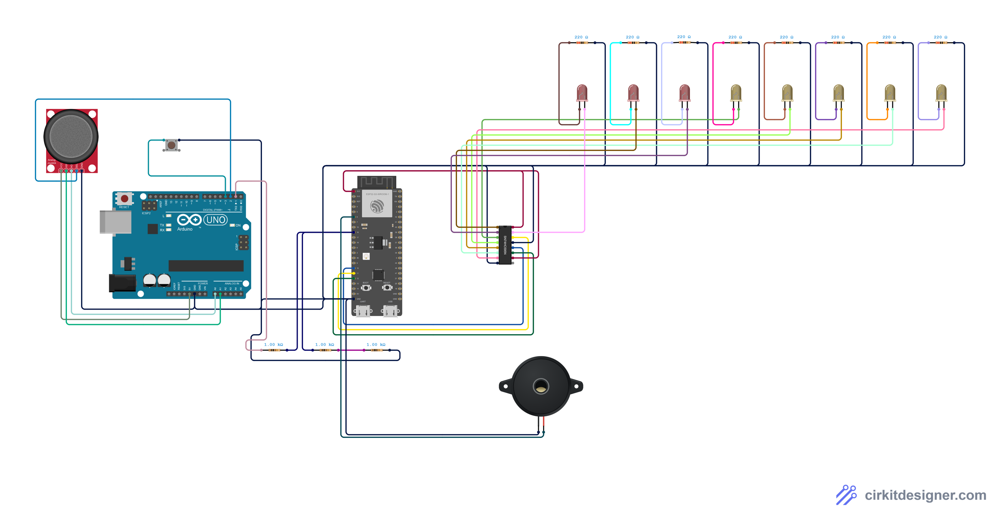
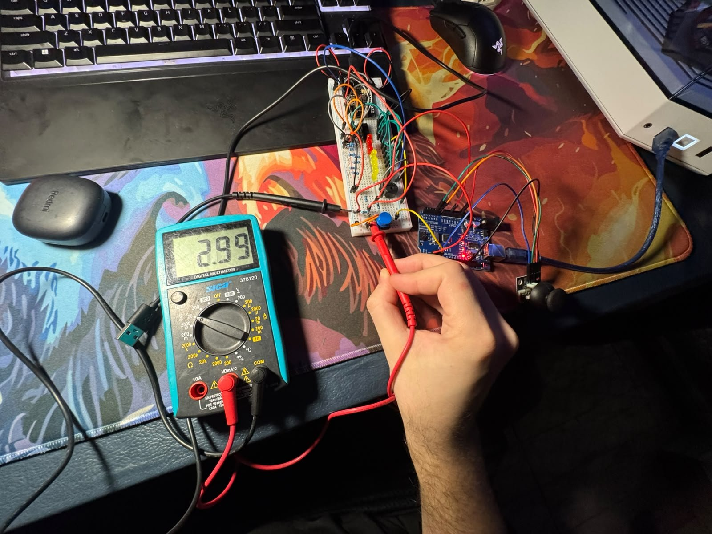

# Kernel Panic · Videojuego IoT con ESP8266

Trabajo práctico de **Arquitectura de Computadoras** · Universidad Nacional de Hurlingham.
Integrantes: **Sebok Rodrigo** y **Trautweiler Franco**.

Juego de plataformas con desplazamiento lateral, al estilo de Mario Bros o Metal Slug. Se juega con un **joystick físico** y un **botón de disparo**, y se ve en tiempo real en una página web servida por el **ESP8266**. Una barra de **8 LEDs** muestra las vidas y el avance, y un **buzzer** hace los efectos de sonido.

El ESP8266 es el centro del sistema: recibe el control, ejecuta la lógica del juego y maneja todas las salidas. Como tiene una sola entrada analógica y el joystick necesita dos, un **Arduino UNO** lee el joystick y los botones y le manda los datos por **UART**. La señal pasa por un **divisor de tensión** que la baja de 5 V a 3,3 V.

El proyecto se desarrolló por etapas:
1. Un prototipo jugable en el navegador, para definir el juego.
2. Una prueba por cada componente en el protoboard: LEDs, buzzer, control, divisor y UART.
3. El juego completo funcionando en el hardware.


---

## Estado del proyecto

| Parte | Estado |
|---|---|
| Diseño del juego (prototipo jugable en el navegador) | ✅ `prototipo_web/index.html` |
| Programa del Arduino UNO (lectura del joystick) | ✅ `arduino_uno/JoystickUNO` |
| Programas de prueba por componente | ✅ `pruebas/` |
| Guía de armado del protoboard | ✅ `docs/guia_armado.html` |
| Póster (Overleaf) | ✅ `poster/poster.tex` |
| Firmware del ESP8266 con el juego de plataformas | ✅ `firmware/KernelPanic` (probado en el hardware, ver `docs/bitacora.md`) |
| Simulación en Cirkit Designer (Arduino UNO + ESP32-S3) | ✅ `cirkit/` · [proyecto](https://app.cirkitdesigner.com/project/a3656b23-a601-4fc2-a228-c781c96eade9) · imagen en `docs/circuito_cirkit.png` |

---

## Contenido del repositorio

```
Kernel_Panic_Game/
├── firmware/KernelPanic/        Firmware del juego para el NodeMCU ESP8266
│   ├── KernelPanic.ino          setup() y loop()
│   ├── config.h                 Wi-Fi, pines y orientación del joystick
│   ├── hardware.h               Lectura del UNO, 74HC595 y buzzer
│   ├── juego.h                  La lógica del juego (nivel, jugador, enemigos, jefe)
│   ├── web.h                    Wi-Fi y servidor web (/, /mapa, /estado)
│   └── pagina.h                 La página del juego guardada en la memoria flash
├── firmware/pagina/pagina.html  Fuente editable de la página (se copia dentro de pagina.h)
├── prototipo_web/index.html     El juego completo en el navegador (simula el hardware)
├── arduino_uno/JoystickUNO/     Programa del Arduino UNO: lee el joystick y lo envía por UART
├── pruebas/                     Un sketch de prueba por componente (para el ESP8266)
│   ├── Prueba1_LEDs_595/        74HC595 y los 8 LEDs
│   ├── Prueba2_Buzzer/          Buzzer
│   ├── Prueba3_Control/         Joystick y botón en el Arduino UNO (diagnóstico)
│   ├── Prueba4_Divisor/         Medición del divisor con el tester (sin programa)
│   ├── Prueba5_UART_UNO/        Recepción de los datos del UNO
│   └── Prueba6_Juego_completo/  Juego completo con los programas finales
├── docs/guia_armado.html        Guía paso a paso del circuito (abrir en el navegador)
├── docs/bitacora.md             Registro de las pruebas del circuito real, paso a paso
├── cirkit/                      Simulación en Cirkit Designer: código del ESP32-S3 (el UNO usa arduino_uno/JoystickUNO)
└── poster/                      Póster en LaTeX para Overleaf
```

---

## Materiales

| Componente | Cantidad | Para qué |
|---|---|---|
| NodeMCU ESP8266 | 1 | Lógica del juego, servidor web y salidas |
| Arduino UNO | 1 | Lee los dos ejes del joystick (el ESP8266 tiene una sola entrada analógica) |
| Joystick analógico KY-023 | 1 | Mover, saltar y agacharse · pulsador SW: iniciar, pausar, reiniciar |
| Pulsador | 1 | Disparar |
| 74HC595 | 1 | Registro de desplazamiento: maneja 8 LEDs con 3 pines |
| LEDs | 8 | 3 rojos (vidas) + 5 amarillos (avance en el nivel) |
| Buzzer | 1 | Efectos de sonido |
| Resistencias 220 Ω | 8 | Una por LED |
| Resistencias 1 kΩ | 3 | Divisor de tensión 5 V → 3,3 V |
| Protoboard de 60 columnas, cables, 2 cables USB | — | Montaje y alimentación |

---

## Arquitectura

```
 Joystick + botón ──► Arduino UNO ──UART──► ESP8266 ──Wi-Fi──► Página web
   (en la mano)       (lee los ejes) 19200   (lógica del juego,   (dibuja el
                                    baudios   servidor web)        juego)
                                               │
                                               ├──► 74HC595 ──► 8 LEDs
                                               └──► Buzzer
```

El UNO manda 50 veces por segundo, a 19200 baudios, una línea de texto: `X,Y,SW,BOTON,CONTROL` (por ejemplo `519,507,1,1,10`). `CONTROL` es un número de verificación (checksum) = (X + 3·Y + 7·SW + 11·BOTON) mod 256: el ESP hace la misma cuenta y descarta la línea si no coincide.

---

## Conexiones



*Circuito completo dibujado en [Cirkit Designer](https://app.cirkitdesigner.com/project/a3656b23-a601-4fc2-a228-c781c96eade9). Cirkit no tiene el ESP8266, así que en el dibujo lo reemplaza un ESP32-S3 con los pines equivalentes: GPIO 16 para recibir del UNO, GPIO 11, 12 y 10 para el 74HC595, y GPIO 6 para el buzzer.*

### Control → Arduino UNO
| Joystick / botón | UNO |
|---|---|
| GND | GND |
| +5V | 5V |
| VRx | A0 |
| VRy | A1 |
| SW | pin 2 |
| Botón de disparo (la otra pata a GND) | pin 3 |

### Arduino UNO → ESP8266 (solo dos cables cruzan entre las placas)
| Desde | Hacia |
|---|---|
| TX del UNO (pin 1) | 1 kΩ → punto de unión → **D2** del ESP8266 |
| Punto de unión | 1 kΩ → 1 kΩ → GND (divisor: 5 V × 2/3 ≈ 3,3 V) |
| GND del UNO | GND del ESP8266 |



*Medición con el tester a la salida del divisor, es decir, en la señal que llega a D2 del ESP8266: **2,99 V**. El TX del UNO trabaja a 5 V y el divisor lo baja a 2/3; el resultado queda por debajo de los 3,6 V que soporta como máximo el ESP8266. En la Prueba 4 de la bitácora se midieron 4,40 V a la entrada y 2,93 V a la salida.*

**Alimentación:** cada placa con su propio cable USB. El 5 V del UNO no se conecta al NodeMCU.

### ESP8266 → salidas
| ESP8266 | Va a |
|---|---|
| 3V3 / GND | Filas + y − del protoboard |
| D7 | 74HC595 pata 14 (DS, datos) |
| D8 | 74HC595 pata 11 (SH_CP, reloj) |
| D0 | 74HC595 pata 12 (ST_CP, latch) |
| D6 | Buzzer + |

74HC595: pata 16 (VCC) y 10 (MR) a 3,3 V; pata 8 (GND) y 13 (OE) a GND. Cada salida Q0–Q7 va a la pata larga de un LED; la pata corta pasa por 220 Ω a GND.
La posición exacta de cada componente en el protoboard está en `docs/guia_armado.html`.

---

## Cómo se juega

| Control | Acción |
|---|---|
| Joystick izquierda / derecha | Caminar |
| Joystick arriba | Saltar |
| Joystick abajo | Agacharse (esquiva los disparos altos) |
| Botón de disparo | Disparar |
| Pulsador SW | Iniciar, pausar y seguir desde el checkpoint |

- El nivel tiene 4 zonas: **fuente de alimentación, placa madre, memoria RAM y CPU**.
- **Puntos:** bit +10 · código corrupto +20 · dron +30 · NÚCLEO-0 +500 · llegar a la CPU +50 por cada vida que quede.
- **Peligros:** código corrupto que se arrastra (se elimina agachado o saltándole encima), drones de vigilancia que persiguen, arcos eléctricos y ventiladores que se encienden y apagan, y pozos.
- **Vidas:** 3. Los parches verdes devuelven una. Al perder todas, la partida termina; con SW se sigue desde el último checkpoint.
- **Final:** NÚCLEO-0 tiene 20 de vida y dos fases. Tira paquetes altos (hay que agacharse) y bajos (hay que saltar).
  - **Fase 1** (20 a 11): se mueve despacio y tira un paquete por vez.
  - **Cambio de fase** (al llegar a 10): se queda quieto 1,5 s con un escudo que absorbe los disparos, borra sus paquetes y suena una alarma.
  - **Fase 2** (10 a 0): se pone rojo y se mueve más rápido. Dispara más seguido y de a dos paquetes a la misma altura.
  - Al eliminarlo se abre la puerta de la CPU.
- **LEDs:** Q0–Q2 vidas, Q3–Q7 avance en el nivel. **Buzzer:** salto, disparo, bit, daño, jefe, cambio de fase, victoria y derrota.

Para probarlo sin hardware, abrí `prototipo_web/index.html` en el navegador. Se juega con las flechas o WASD, se dispara con K, X o J, y SW es Espacio o Enter. Al costado se ve lo que vería el ESP8266: los valores del joystick, el byte enviado al 74HC595, el buzzer y el JSON de `/estado`.

---

## Cómo cargarlo

1. **Arduino UNO:** abrir `arduino_uno/JoystickUNO/JoystickUNO.ino`, placa *Arduino Uno*, cargar. En el Monitor Serie (19200 baudios) aparecen las lecturas.
2. **ESP8266:** instalar el núcleo *esp8266* en el Gestor de placas y elegir *NodeMCU 1.0 (ESP-12E Module)*. Probar cada parte con las pruebas de `pruebas/` en orden, de la 1 a la 6.
3. **El juego:** abrir `firmware/KernelPanic/KernelPanic.ino` (el IDE abre también las pestañas `.h`).
   - En `config.h`, poner el nombre y la clave del Wi-Fi en `WIFI_RED` y `WIFI_CLAVE`.
   - Cargarlo en el NodeMCU (en nuestra PC, COM3) y abrir el Monitor Serie a 115200: muestra la dirección para abrir en el navegador, por ejemplo `http://192.168.0.25`.
   - Si no logra conectarse a esa red en 10 segundos, el ESP crea la suya: **KernelPanic-ESP** (clave `kernelpanic`). Con el celular conectado a esa red, el juego se abre en `http://192.168.4.1`.
   - No hace falta instalar bibliotecas: todo viene con el soporte de placas ESP8266.
4. Si al cargar el ESP8266 falla con todo conectado, desconectar el cable de D8 mientras se carga.
5. **Orientación del joystick:** en nuestro control el módulo quedó girado 90°, así que `config.h` intercambia los ejes (`INTERCAMBIAR_EJES 1`) e invierte el vertical (`INVERTIR_Y 1`). Si en otro armado las direcciones quedan mal, se corrigen cambiando esos valores.

---

## Explicaciones para la defensa

### 1. ¿Cómo se leen los ejes del joystick?
El joystick tiene dos potenciómetros: VRx (izquierda-derecha) y VRy (arriba-abajo). Cada uno entrega un voltaje entre 0 y 5 V. El ESP8266 tiene una sola entrada analógica, así que el **Arduino UNO** los convierte con `analogRead()` a números de 0 a 1023 y envía la línea `X,Y,SW,BOTON,CONTROL` cada 20 ms por UART a 19200 baudios. El ESP la recibe con `SoftwareSerial` en D2, la arma carácter por carácter sin bloquear y la valida: si está incompleta, tiene valores fuera de rango o el número de verificación no coincide, la descarta. La página muestra cuántas líneas llegaron bien y cuántas se descartaron.

### 2. ¿Cómo se determinan las direcciones?
Se calcula cuánto se alejó cada eje del centro (Δx = X − 512, Δy = Y − 512). Si los dos desvíos son menores que la **zona muerta** (±150), la dirección es CENTRO: así se evitan movimientos por el ruido o porque la palanca no vuelve exactamente al medio. Si no, gana el eje con mayor desvío y el signo indica el sentido: izquierda/derecha o arriba/abajo.

### 3. ¿Cómo se detecta la pulsación?
El pulsador SW y el botón de disparo usan `INPUT_PULLUP` en el UNO: sueltos valen 1 y presionados 0. El ESP detecta el **flanco**, es decir el momento en que el valor pasa de 1 a 0, para que una pulsación cuente una sola vez aunque se mantenga apretado. Además, un cambio solo se acepta si se repite en dos lecturas seguidas (antirrebote).

### 4. ¿Cómo se controla el movimiento del jugador?
El nivel es una grilla de 224 × 15 casillas guardada como texto. Izquierda y derecha mueven a K-1T una casilla si no hay una pared. Arriba inicia un salto: sube 3 casillas, flota un instante y cae acelerando. Abajo lo agacha (pasa a ocupar 1 casilla en lugar de 2). Las plataformas finas se atraviesan desde abajo, y las móviles lo llevan encima.

### 5. ¿Cómo funciona la lógica del videojuego?
Todo avanza en **pasos de 50 ms** medidos con `millis()`. No se usa `delay()`, porque congelaría la lectura del joystick y el servidor web. En cada paso se leen las entradas, se mueve al jugador, se avanzan las balas, se mueven los enemigos cercanos a la cámara y se revisan las colisiones. Después se actualizan los puntos, los LEDs y el buzzer. El juego es una **máquina de estados**: MENÚ → JUGANDO ⇄ PAUSA → PERDIDO o GANADO.

### 6. ¿Cómo se comunica el ESP8266 con la página web?
El ESP8266 funciona como **servidor web** con dos rutas:
- `/` devuelve la página del juego, guardada en la memoria flash (`PROGMEM`) para no ocupar RAM.
- `/estado` devuelve en **JSON** (biblioteca ArduinoJson) la posición del jugador, los enemigos, las balas, los puntos, el estado de la partida, el joystick, los LEDs y el buzzer.

### 7. ¿Cómo se actualiza el juego en tiempo real?
La página pide `/estado` con `fetch()` cada 100 ms y dibuja lo que recibe en un `<canvas>`. La página no calcula el juego, solo lo muestra; para que se vea fluido, interpola las posiciones entre una respuesta y la siguiente.

---

## Problemas encontrados y soluciones

| Problema | Solución |
|---|---|
| El ESP8266 tiene una sola entrada analógica y el joystick necesita dos | Arduino UNO como lector del joystick, comunicado por UART |
| El UNO trabaja a 5 V y el ESP8266 a 3,3 V | Divisor de tensión con 3 resistencias de 1 kΩ en la señal TX, y cada placa alimentada por su propio USB |
| Faltaban pines para 8 LEDs | 74HC595: 8 salidas con 3 pines |
| `delay()` congela el servidor web | Reloj del juego con `millis()` |
| El Arduino IDE no mostraba el puerto del NodeMCU | El cable USB era solo de carga; con otro cable apareció el chip CP2102 sin driver y se instaló el driver CP210x de Silicon Labs |
| Los ejes del joystick quedaban fijos en 1023 | Falso contacto en el GND del joystick; se ajustaron los cables |
| El botón de disparo daba siempre 0 o no cambiaba | Estaba girado (patas unidas por dentro) y en el pin equivocado; se giró 90° y se pasó al pin 3 |
| Con el juego andando, los botones respondían a veces sí y a veces no | `SoftwareSerial` del ESP8266 leía mal algunos caracteres mientras atendía el Wi-Fi. Se bajó la velocidad a 19200 baudios y se agregó un número de verificación a cada línea para descartar las que llegan con errores |
| Los 5 LEDs amarillos no encendían | Estaban colocados al revés; se dieron vuelta (la pata larga va hacia la salida del 595) |
| Cirkit Designer no tiene el ESP8266 | La simulación usa un ESP32-S3 con pines equivalentes (GPIO 16, 11, 12, 10 y 6) |
| Los LEDs de 5 mm no entran en columnas seguidas | Se ubican en columnas alternadas (29, 31, … 43) |
| En el protoboard, las filas + y − de un lado están en orden inverso al dibujo | Se conecta siguiendo el color de la línea (roja = 3,3 V, azul = GND), no la posición |
| El nombre `Dir` chocaba con una clase del núcleo del ESP8266 | Se renombró a `Direccion` |
| El jefe no se movía cuando estaba lejos de la cámara | El jefe se actualiza siempre y la cámara se fija durante la pelea |
